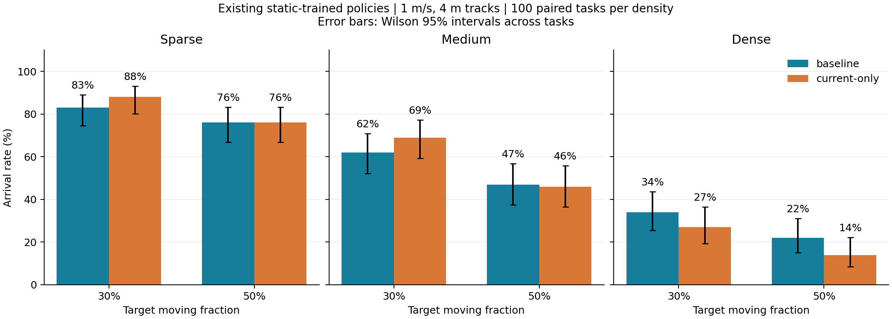

# MAVRL in Isaac Sim

MAVRL 的 Isaac Sim 5.1 迁移与静态／动态圆柱导航实验。保留官方 VAE（潜变量 64）、LSTM（256）和缓存冻结表征的 PPO 路径，采用 10 Hz 简化加速度运动学与 256×256 RTX 深度。当前包含静态训练基线，以及原有圆柱运动时的直接迁移评估；未加入 C3BF、安全过滤器或动态场景重训。

## 已完成结果

三组静态 PPO 均训练 800 万步，训练 seed=0。每组每档密度使用相同的 100 个任务。

| 静态配置 | 稀疏到达率 | 中等到达率 | 密集到达率 |
|---|---:|---:|---:|
| baseline：过去＋当前重建 | 100% | 98% | 89% |
| current-only：仅当前重建，保留 LSTM | 100% | 99% | 89% |
| fixed：目标速度奖励 | 100% | 98% | 81% |

动态实验直接使用上述 baseline/current-only 权重。原有圆柱的半径、高度、总数和初始位置保持不变；选中圆柱以 1 m/s 沿 4 m 线段往返。

| 动态设置 | 模型 | 稀疏 | 中等 | 密集 |
|---|---|---:|---:|---:|
| 3 个原有圆柱移动 | baseline | 94% | 89% | 81% |
| 3 个原有圆柱移动 | current-only | 98% | 89% | 81% |
| 30% 原有圆柱移动 | baseline | 83% | 62% | 34% |
| 30% 原有圆柱移动 | current-only | 88% | 69% | 27% |
| 50% 原有圆柱移动 | baseline | 76% | 47% | 22% |
| 50% 原有圆柱移动 | current-only | 76% | 46% | 14% |

30%/50% 按每张地图总数四舍五入，30% 的运动集合是 50% 的固定子集。为实现高比例，这两档采用精确相对运动距离检查；上轮 3 个移动圆柱使用更保守的轨迹筛选规则，不能把跨轮差异全部归因于比例。

所有结论限定于单训练种子及已测环境。current-only 仍有历史隐状态；本轮静态结果未显示过去帧重建提高到达率。动态密集场景出现的局部优势不构成普遍、跨种子或等速度优势。

- [静态复现报告](docs/REPRODUCTION_REPORT.md) · [静态结果与权重清单](artifacts/delivery_20261106/RESULTS.md)
- [3 个动态圆柱报告](artifacts/dynamic_existing_20261106/RESULTS.md) · [环境说明](docs/DYNAMIC_EVALUATION.md)
- [30%/50% 动态报告](artifacts/dynamic_fraction_20261106/RESULTS.md) · [环境说明](docs/DYNAMIC_FRACTION_EVALUATION.md)



## 仓库内容与依赖

本仓库上传代码、配置、测试、文档和选定的实验结果，包括逐任务记录、场景清单、训练曲线数据、图表与校验信息。**训练权重、深度数据集、较大的逐秒轨迹、渲染日志、历史源码快照、Python/Isaac 环境和缓存不随仓库上传。** 原始完整产物保留在实验机器上。文件范围见 [GITHUB_UPLOAD.md](docs/GITHUB_UPLOAD.md)，上传清单见 [REPOSITORY_FILES.json](docs/REPOSITORY_FILES.json)。

运行依赖 Isaac Sim 5.1、Python 3.11 和兼容 RTX/CUDA/PyTorch 环境。已验证环境为 PyTorch 2.7+cu128，详细版本见 [ENVIRONMENT.md](docs/ENVIRONMENT.md)。项目不会替换共享环境。

官方源码不随仓库分发；运行和 CPU 测试需要固定版本的 MAVRL 源码：

```bash
git clone https://github.com/pink-L/MAVRL_IsaacSim.git
cd MAVRL_IsaacSim
git clone https://github.com/tudelft/mavrl.git upstream/mavrl
git -C upstream/mavrl checkout 813b8875ba00c838e08286a3f8518c6167546f74

# 使用已具备兼容依赖的 Python 创建本地环境
/path/to/compatible/python -m venv --system-site-packages .venv
scripts/python.sh -m unittest discover -s tests -v
```

AvoidBench 原始代码仅用于源码对照，固定 commit 为 `b9afb971ea85a98ee98125764e93513c9cf64457`；来源见 [SOURCE_AUDIT.md](docs/SOURCE_AUDIT.md)。不需要构建 Flightgym、下载 Unity 场景或引入完整四旋翼动力学。

## 评估与训练入口

已有权重的加载、评估、复训及从头训练命令见 [HANDOFF.md](docs/HANDOFF.md)。仓库中的路径和 SHA256 保留原始实验记录，**GitHub 上的结果文件不意味着权重已上传**；执行下例前需自行取得清单中的权重，并放到相应路径。

```bash
scripts/python.sh scripts/run.py evaluate \
  --config configs/isaac_capture2_dynamic_30pct.json \
  --policy artifacts/capture2_baseline_seed0/final/latest.pt \
  --out artifacts/my_new_evaluation/pct30_baseline \
  --episodes 100 --num-envs 16 --seed 200
```

50% 改用对应配置；current-only 改用其权重路径并加 `--current-only`。两个比例配置引用已上传的共享轨迹清单，覆盖固定的三档密度各 100 个任务。其他地图应另行准备轨迹，不能静默减少动态圆柱数量。

统一入口为 `scripts/run.py`，完整训练流水线为 `scripts/run_long_pipeline.py`。原静态配置未启用动态障碍时保持原行为。新运行应使用独立输出目录，避免覆盖已交付产物。

## 算法和场景边界

- 场地为 40×40 m；圆柱高 8 m，半径 0.5–3 m；稀疏／中等／密集采用 Poisson 布置。
- 保留源码中的 FLU/RFU 坐标、状态顺序、奖励角度处理、终止奖励覆盖，以及初始共享／重载独立 critic LSTM 的行为。
- 最终 PPO 冻结 encoder/LSTM，仅优化策略和价值头；不是端到端 RecurrentPPO。
- RTX 理想轴向深度没有复制原双目 SGM 噪声。已阅读的是 2024 arXiv v1，未取得 2025 最终版全文。
- 动态场景初始可行性不保证整个运动过程始终有可行路径。重复检查只支持已测试的硬件、软件和任务范围。

[源码审计](docs/SOURCE_AUDIT.md) · [并行性能](docs/PARALLELISM.md) · [取帧同步调查](audit/CAPTURE_SYNC.md)

## 本地历史

首次上传通过已连接的 GitHub 账户完成。本地前 26 个提交截至 `e854c3abf390e45b5f4e1399cfaaeff98dcf9737` 的完整历史保存在 [Git bundle](history/local-history-through-e854c3a.bundle) 中，可用 `git bundle verify` 检查、用 `git clone <bundle> <新目录>` 恢复。GitHub 的发布提交记录本次代码与结果快照。
