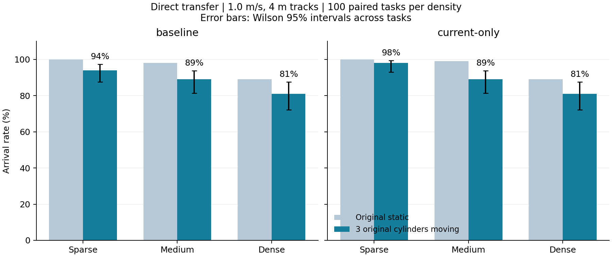

# 原有圆柱运动：MAVRL 直接迁移评估

原地图中选取 3 个有移动空间的圆柱，保留半径和初始位置，以 1.0 m/s 在 4 m 线段上往返。障碍物总数不变。baseline 和 current-only 均直接加载已交付权重，没有重新训练。每档 100 个相同任务，共 300 个配对任务、600 次正式导航。

| 模型 | 密度 | 原静态到达率 | 动态到达率 | 静止/移动/同时碰撞数 | 越界/超时数 | 平均速度 m/s |
|---|---|---:|---:|---:|---:|---:|
| baseline | sparse | 100% | 94% | 1/5/0 | 0/0 | 2.227 |
| baseline | medium | 98% | 89% | 4/7/0 | 0/0 | 2.145 |
| baseline | dense | 89% | 81% | 12/7/0 | 0/0 | 1.899 |
| current_only | sparse | 100% | 98% | 0/2/0 | 0/0 | 2.099 |
| current_only | medium | 99% | 89% | 2/9/0 | 0/0 | 2.006 |
| current_only | dense | 89% | 81% | 10/9/0 | 0/0 | 1.762 |

碰撞类型只统计碰撞终止的任务；速度沿用交付的源码 FLU 水平分量模长，并按 episode 等权平均。图中误差线为动态评估到达率的 Wilson 95% 区间，仅描述场景任务的不确定性，不包含训练种子差异。

| 密度 | 两者成功 | 仅 baseline 成功 | 仅 current-only 成功 | 两者失败 |
|---|---:|---:|---:|---:|
| sparse | 93 | 1 | 5 | 1 |
| medium | 82 | 7 | 7 | 4 |
| dense | 71 | 10 | 10 | 9 |

| 模型 | 密度 | 静态成功→动态失败 | 静态失败→动态成功 |
|---|---|---:|---:|
| baseline | sparse | 6 | 0 |
| baseline | medium | 9 | 0 |
| baseline | dense | 10 | 2 |
| current_only | sparse | 2 | 0 |
| current_only | medium | 11 | 1 |
| current_only | dense | 11 | 3 |

验证与范围：

- 30 项 CPU 测试通过，300 张地图通过几何检查；两组正式评估的完整场景/轨迹参数逐项一致，原权重 SHA256 保持一致。
- 真实 RTX 探针确认原圆柱运动会改变深度，回到原时刻的图像逐像素一致。两组各 9 个任务的独立重复评估中，episode、trajectory、scene 文件 SHA256 一致；没有把这 36 次检查纳入正式样本。
- 保留原始静态 TRAV 用于奖励日志；不以奖励均值作为动态导航能力的主要结论。
- 结论限于单训练种子、每图 3 个移动圆柱、1.0 m/s、4 m 轨迹。可移动圆柱需具有足够空间，完整轨迹不碰静止物体和起终点；未证明动态全过程的路径可行性。
- current-only 仍具有 LSTM 历史状态；本轮差异不构成跨种子稳定优势或普遍记忆收益的证据。
- 原静态对照来自已交付的相同任务。用户选型之前的新增圆柱探针已停止，其结果未纳入本报告。

完整设置见 `protocol.json`，原始结果见 `baseline_full/`、`current_only_full/`，配对结果及摘要见 `comparison.json`。

