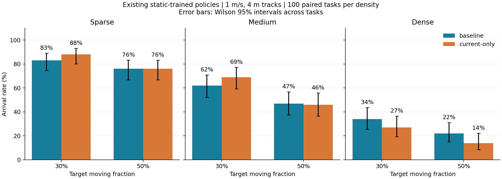

# 原有圆柱 30% / 50% 动态比例评估

直接加载原静态训练的 baseline 与 current-only 权重，无训练、奖励修改或安全过滤器。每个比例、每个模型分别完成三档密度×100 个任务，共 1200 次正式导航。

运动保持 1.0 m/s、4 m 直线往返，从原位置（轨迹中点）出发；场地、任务、障碍物总数、尺寸和高度保持原值。动态数量为 floor(N×比例+0.5)，奇数地图的 50% 向上取整。30% 的移动集合及轨迹是 50% 的固定前缀。

| 比例 | 模型 | 密度 | 到达率 | 静止/移动/同时碰撞数 | 越界/超时数 | 平均速度 m/s |
|---|---|---|---:|---:|---:|---:|
| 30% | baseline | sparse | 83% | 0/17/0 | 0/0 | 2.227 |
| 30% | baseline | medium | 62% | 1/37/0 | 0/0 | 2.118 |
| 30% | baseline | dense | 34% | 11/55/0 | 0/0 | 1.808 |
| 30% | current_only | sparse | 88% | 0/12/0 | 0/0 | 2.089 |
| 30% | current_only | medium | 69% | 0/31/0 | 0/0 | 2.008 |
| 30% | current_only | dense | 27% | 13/60/0 | 0/0 | 1.711 |
| 50% | baseline | sparse | 76% | 0/24/0 | 0/0 | 2.223 |
| 50% | baseline | medium | 47% | 1/52/0 | 0/0 | 2.114 |
| 50% | baseline | dense | 22% | 2/76/0 | 0/0 | 1.813 |
| 50% | current_only | sparse | 76% | 0/24/0 | 0/0 | 2.087 |
| 50% | current_only | medium | 46% | 0/54/0 | 0/0 | 1.991 |
| 50% | current_only | dense | 14% | 8/78/0 | 0/0 | 1.701 |

| 比例 | 密度 | 每图动态数范围 | 平均动态数 | 平均实际动态比例 |
|---|---|---:|---:|---:|
| 30% | sparse | 6–8 | 6.73 | 30.31% |
| 30% | medium | 11–14 | 12.84 | 30.21% |
| 30% | dense | 23–27 | 25.21 | 30.14% |
| 50% | sparse | 10–13 | 11.42 | 51.45% |
| 50% | medium | 19–24 | 21.52 | 50.64% |
| 50% | dense | 38–45 | 42.03 | 50.25% |

速度沿用原 FLU 水平分量模长，先求每个任务的均值，再按任务等权平均；不把两组当作等速度对照。

| 比例 | 密度 | 两者成功 | 仅 baseline 成功 | 仅 current-only 成功 | 两者失败 |
|---|---|---:|---:|---:|---:|
| 30% | sparse | 78 | 5 | 10 | 7 |
| 30% | medium | 51 | 11 | 18 | 20 |
| 30% | dense | 16 | 18 | 11 | 55 |
| 50% | sparse | 65 | 11 | 11 | 13 |
| 50% | medium | 28 | 19 | 18 | 35 |
| 50% | dense | 10 | 12 | 4 | 74 |

| 模型 | 密度 | 30% 成功→50% 失败 | 30% 失败→50% 成功 |
|---|---|---:|---:|
| baseline | sparse | 10 | 3 |
| baseline | medium | 23 | 8 |
| baseline | dense | 20 | 8 |
| current_only | sparse | 14 | 2 |
| current_only | medium | 26 | 3 |
| current_only | dense | 22 | 9 |

历史参考：

| 模型 | 密度 | 原静态 | 上轮 3 个移动 | 本轮 30% | 本轮 50% |
|---|---|---:|---:|---:|---:|
| baseline | sparse | 100% | 94% | 83% | 76% |
| baseline | medium | 98% | 89% | 62% | 47% |
| baseline | dense | 89% | 81% | 34% | 22% |
| current_only | sparse | 100% | 98% | 88% | 76% |
| current_only | medium | 99% | 89% | 69% | 46% |
| current_only | dense | 89% | 81% | 27% | 14% |

实现与证据边界：

- 35 项 CPU 测试通过。全部 300 张原地图预先生成共享 50% 轨迹，并检查完整周期内移动圆柱之间不相交；每条轨迹还避开所有其他圆柱的原始静止位置和起终点净空。未丢弃地图、降低动态数量或修改原始几何。
- 原来的轨迹包围圆互不相交约束过于保守，无法支持部分密集地图的高比例。本轮改为精确的相对运动距离检查，圆柱实体表面间隔至少 1 mm；30% 与 50% 采用同一规则。
- 上轮 3 个动态圆柱使用不同的轨迹筛选规则，因此它与本轮的差异不能完全归因于动态比例。原静态、上一轮权重和日志均保留。
- 50% 档每个模型各 9 个任务进行了两次独立运行，episode、trajectory、scene 的 SHA256 一致；这些 36 次检查不计入正式样本。四组正式评估源码一致，两组模型的任务/运动参数一致，两个比例的轨迹满足嵌套关系。
- 单训练种子、单运动速度与轨迹长度；current-only 保留 LSTM 状态。初始地图可行性不保证动态全过程存在可行路径，重复探针不保证跨硬件或所有未来帧绝对确定性。
- 图中误差线是场景任务到达率的 Wilson 95% 区间，不包含训练种子随机性。

配置与轨迹来源见 `protocol.json`、`master_tracks.json`；全部原始结果保存在各 `pct*_full/` 目录；机器可读统计见 `comparison.json`。

